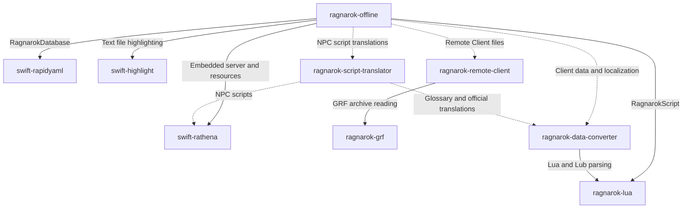

# Ragnarok Offline


## Prerequisites
Before installing Ragnarok Offline there are certain hardwares you will need.

Hardware | OS Version    | Required
---------|---------------|---------
Mac      | 15.0 or later | Yes
iPad     | 18.0 or later | No

## Installation

1. Install [Xcode](https://developer.apple.com/xcode/downloads/) with the iOS 18, macOS 15, and visionOS 2 SDKs.
1. Make sure the Xcode command line tools point at the installed Xcode:
    ```shell
    xcode-select --install
    sudo xcode-select --switch /Applications/Xcode.app
    ```
1. Clone the repository with submodules:
    ```shell
    git clone --recurse-submodules https://github.com/arkadeleon/ragnarok-offline
    cd ragnarok-offline
    ```
    If you already cloned the repository without submodules, run:
    ```shell
    git submodule update --init --recursive
    ```
1. Open `RagnarokOffline.xcodeproj` in Xcode.
1. Select the `RagnarokOffline` scheme.
1. Select a run destination:
    - `My Mac` to run the macOS app.
    - An iOS simulator to run on iPad or iPhone Simulator.
    - An Apple Vision Pro simulator to run the visionOS app.
    - A connected iPad, iPhone, or Apple Vision Pro device to run on real hardware.
1. Wait for Xcode to resolve local Swift package dependencies, then build and run with `Product > Run`.

## Related projects and dependency graph

Ragnarok Offline combines embedded server code, Swift libraries, client data and localization, and an optional Remote Client. Arrows point from a project to the dependency or resource it uses. Solid arrows show build dependencies; dotted arrows show data preparation or HTTP resource access.



| Project | Role in Ragnarok Offline |
| --- | --- |
| [swift-rathena](https://github.com/arkadeleon/swift-rathena) | Git submodule and local Swift package providing the embedded rAthena servers, databases, and NPC scripts. Also supplies source definitions for the constants and packet generator. |
| [ragnarok-grf](https://github.com/arkadeleon/ragnarok-grf) | Standalone GRF archive reader used by the remote client. This app currently reads local archives through its own `Packages/RagnarokGRF` package. |
| [ragnarok-lua](https://github.com/arkadeleon/ragnarok-lua) | Swift package used by `RagnarokScript` to execute Lua and decompile client `.lub` files; also used by the data converter. |
| [ragnarok-remote-client](https://github.com/arkadeleon/ragnarok-remote-client) | Optional HTTP server that serves client files and extracts GRF entries on demand. Configure its URL in the app's Remote Client settings. |
| [ragnarok-script-translator](https://github.com/arkadeleon/ragnarok-script-translator) | Tool that extracts and translates rAthena NPC scripts and exports the translations to `ScriptText.json`. Uses the data converter's resources for the glossary and official translations. |
| [ragnarok-data-converter](https://github.com/arkadeleon/ragnarok-data-converter) | Tool that converts client files from different regions into JSON files for `RagnarokLocalization`, including item names and descriptions, map names, monster names, skill descriptions, and messages. |
| [swift-rapidyaml](https://github.com/arkadeleon/swift-rapidyaml) | Provides the `RapidYAML` product used by `RagnarokDatabase` to parse rAthena YAML databases. |
| [swift-highlight](https://github.com/arkadeleon/swift-highlight) | Provides text file syntax highlighting in `TextFilePreviewView`. |

The converter and translator run separately when preparing bundled data; they are not part of the app build. The remote client is optional: local client files support fully offline use.
